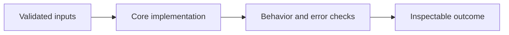

# Inventory and Sales Orchestration

**Feras Elghandour** · Technical case study

Ensure a sales workflow cannot promise stock twice or leave a partially written order after an error.

## Implementation

A standalone SQLite reservation core with integer-cent quotes, quantity/date validation, atomic inventory updates, unique order identifiers, and rollback on failure.



## Evidence and results

The completed sales-agent project combines customer requests with inventory, quote, order, and delivery reasoning. This portable release focuses on transaction integrity. Synthetic checks verify quoting, successful reservation, oversell rejection, duplicate-order rollback, and deadline validation.

This public edition contains a standalone refactor and focused tests. Saved experimental outcomes and the current component checks have separate scopes; the refactor has not been used to recertify the original benchmark.

## Run the checks

Python 3.11 or later.

```sh
python -m venv .venv
source .venv/bin/activate
python -m pip install -r requirements.txt
python smoke_test.py
```

See [DATA.md](DATA.md) for input contracts and [VALIDATION.md](VALIDATION.md) for the verification scope. The modules expose small APIs that can be integrated into a larger workflow.

## Practical relevance and limitations

The core does not implement payment processing, supplier replenishment, delivery guarantees, or a live customer service. Agent-generated plans must still pass the deterministic inventory transaction before becoming orders.

No client deployment, commercial outcome, or new live-provider performance is inferred from the component tests.
