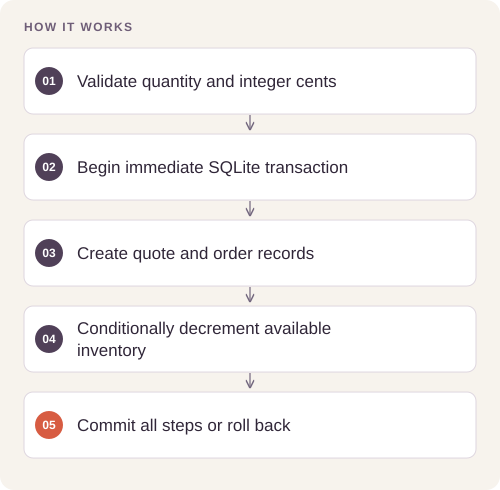

# Inventory and Sales Orchestration

Ensure a sales workflow cannot promise stock twice or leave a partially written order after an error.

## Implementation

A standalone SQLite reservation core with integer-cent quotes, quantity/date validation, atomic inventory updates, unique order identifiers, and rollback on failure.




## Reproduce and inspect

The executable reproduction profile now records exact commands, input/source hashes, dependency versions, logs and pass/fail status. Its scope distinguishes behavior checks from full-data benchmarks.

[Commands, artifacts and benchmark scope](BENCHMARKS.md) · [Versioned profiles](reproduction.json)


## Try a small example

A small offline fixture exercises the public implementation. It demonstrates the behavior shown below; it does not replace the historical dataset, benchmark or production validation.

After the local setup below, run from the repository root:

```sh
python examples/quickstart.py
```

The [example source](examples/quickstart.py), [captured output](examples/expected-output.txt) and [execution record](examples/environment.json) keep this demonstration inspectable. Floating-point values may vary with library versions.

Observed output from this run:

```text
{'total_cents': 375, 'items': {'demo': 3}}
{'stock_remaining': 7}
```

## Evidence and results

The completed sales-agent project combines customer requests with inventory, quote, order, and delivery reasoning. This portable release focuses on transaction integrity. Synthetic checks verify quoting, successful reservation, oversell rejection, duplicate-order rollback, and deadline validation.

This public edition contains a standalone refactor and focused tests. Saved experimental outcomes and the current component checks have separate scopes; the refactor has not been used to recertify the original benchmark.

## Run the checks

Python 3.11 or later.

```sh
python -m venv .venv
source .venv/bin/activate
python -m pip install -r requirements.txt
python smoke_test.py
```

See [DATA.md](DATA.md) for input contracts and [VALIDATION.md](VALIDATION.md) for the verification scope. 

## Practical relevance and limitations

The core does not implement payment processing, supplier replenishment, delivery guarantees, or a live customer service. Agent-generated plans must still pass the deterministic inventory transaction before becoming orders.

No client deployment, commercial outcome, or new live-provider performance is inferred from the component tests.
